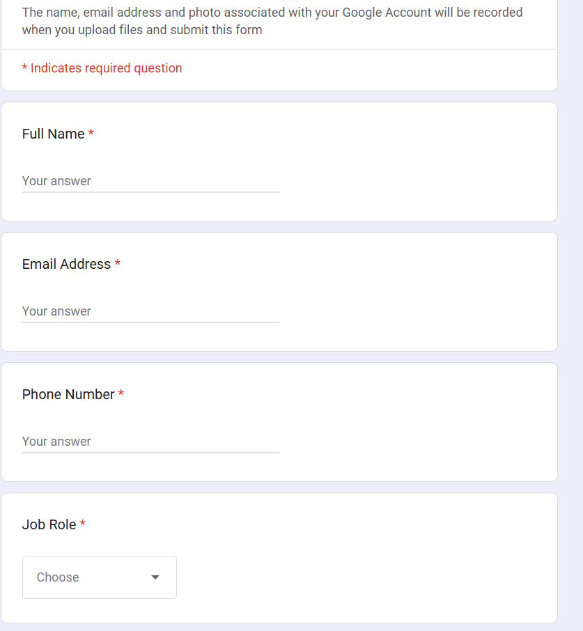
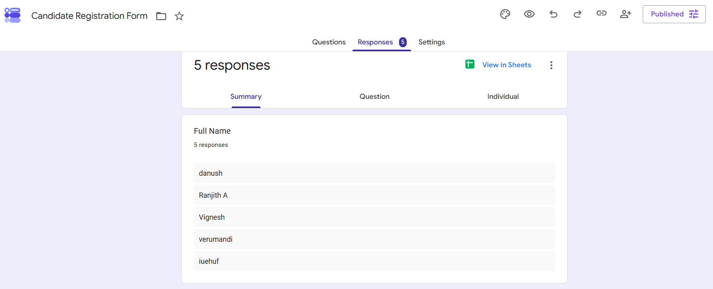
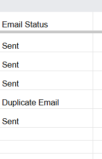
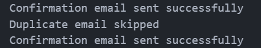

# Candidate Email Automation

This project automates the first step of the hiring process by monitoring a Google Form, validating candidate submissions, and sending a professional application acknowledgment email through Gmail.

The workflow is implemented in a Jupyter notebook and uses Google Sheets for data collection, Gmail SMTP for sending emails, and a local Ollama LLM to generate the message content.

## Overview

Recruitment teams often receive multiple candidate applications from a form or registration page. Manually replying to each candidate is time-consuming and error-prone. This automation solves that by:

- watching new responses in a Google Sheet
- checking required candidate details and email validity
- preventing duplicate email sends
- drafting a professional response email
- logging each result back into the sheet

## Features

- Auto-monitoring of Google Form responses every 30 seconds
- Google Sheets integration with automatic status tracking
- Email format validation and required-field checks
- Duplicate email detection before sending
- LLM-assisted email drafting using a local model
- Gmail SMTP delivery for candidate notifications
- Status values such as Sent, Duplicate Email, Invalid Email, Missing Details, and Failed

## Tech Stack

- Python
- Jupyter Notebook
- Google Forms + Google Sheets API
- Gmail SMTP
- LangChain
- Ollama
- `gspread`
- `google-auth`
- `python-dotenv`

## How it works

1. A candidate submits a form with their details.
2. The response is stored in Google Sheets.
3. The notebook checks for new rows in the sheet.
4. It validates required information and email format.
5. It compares the email against earlier entries to avoid duplicates.
6. It generates an application acknowledgment email using an LLM.
7. It sends the email through Gmail SMTP.
8. It writes the result to the Email Status column.

## Project structure

```text
Email_Automation/
├── .gitignore
├── README.md
├── requirements.txt
├── notebooks/
│   └── Email_Automation_Agent.ipynb
├── screenshots/
│   ├── candidate-registration-form.png
│   ├── google-form-responses.png
│   ├── email-status-tracking.png
│   └── automation-logs.png
├── secrets/
│   ├── .env.example
│   ├── .env
│   ├── credentials.json
│   └── token.json
└── .venv/
```

## Screenshots

### Candidate registration form



### Google Forms responses



### Email status tracking



### Automation logs



## Setup and usage

### 1. Clone the repository

```bash
git clone <your-repo-url>
cd "Email Automation"
```

### 2. Create a virtual environment

```bash
python -m venv .venv
```

On Windows:

```bash
.venv\Scripts\activate
```

On macOS/Linux:

```bash
source .venv/bin/activate
```

### 3. Install dependencies

```bash
pip install -r requirements.txt
pip install langchain langchain-ollama
```

### 4. Configure environment variables and credentials

Copy the sample file and fill in your Gmail details:

```bash
copy secrets\.env.example secrets\.env
```

Then update `secrets/.env` with:

```env
GMAIL_ADDRESS=yourgmail@gmail.com
GMAIL_APP_PASSWORD=your_app_password
```

Place your Google OAuth `credentials.json` file inside `secrets/` and run the notebook once to generate `secrets/token.json`.

Make sure the Gmail account has an App Password enabled if using Gmail 2-Step Verification.

### 5. Install Ollama and pull the model

This project uses the model `qwen3:1.7b`.

```bash
ollama pull qwen3:1.7b
```

### 6. Run the notebook

Open `notebooks/Email_Automation_Agent.ipynb` in Jupyter Notebook or VS Code and run the cells in order.

The automation will continue polling the worksheet every 30 seconds until you stop it.

## Important notes

- `SPREADSHEET_URL` must point to your live Google Sheet.
- The script adds an `Email Status` column automatically if it does not exist.
- Do not share your Gmail app password or Google credentials.
- Keep all files inside `secrets/` protected and never commit them to version control.

## Potential improvements

- Add retry logic for failed SMTP sends
- Add a dashboard for recruitment tracking
- Improve duplicate detection across multiple sheets or workflows
- Move the automation to a scheduled cloud service
- Add detailed logging and alerting

## Author

Ranjith Kumar.
